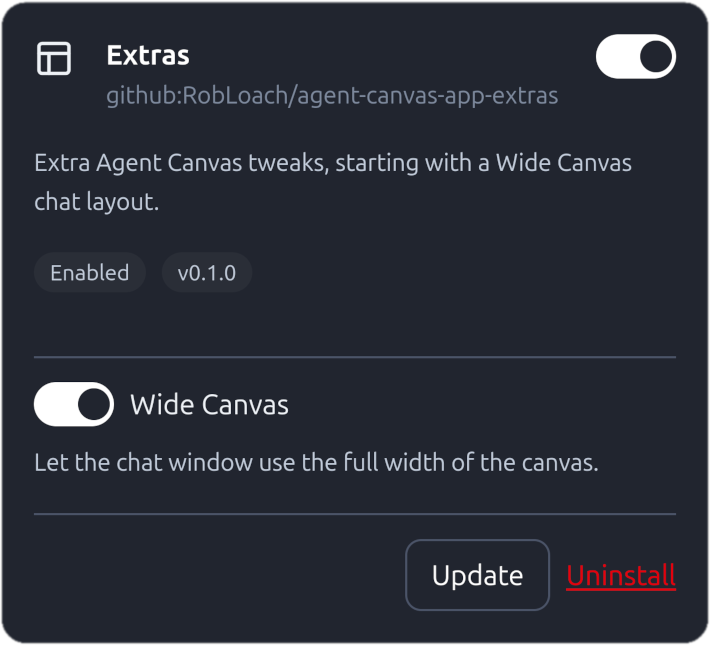

# Agent Canvas App: Extras

An [OpenHands](https://www.openhands.dev/) Agent Canvas app which adds a few extra UI tweaks.



## Features

| Name | Description |
| :-- | :-- |
| **Wide Canvas** | Removes the maximum width cap from the chat window so the conversation fills the full canvas width. |

## Install

1. Visit **Customize > Apps** (`/apps`)
2. Click on **Add app** at the top right
3. For the App source, enter:
   ```
   github:RobLoach/agent-canvas-app-extras
   ```
4. Click **Install**
5. **Enable** the Extras app
6. Configuration appears directly in the Extras card

## Development

Feel free to propose more features in the issue queue. All app settings are stored in the browser's `localStorage`.

## License

[MIT](LICENSE)
